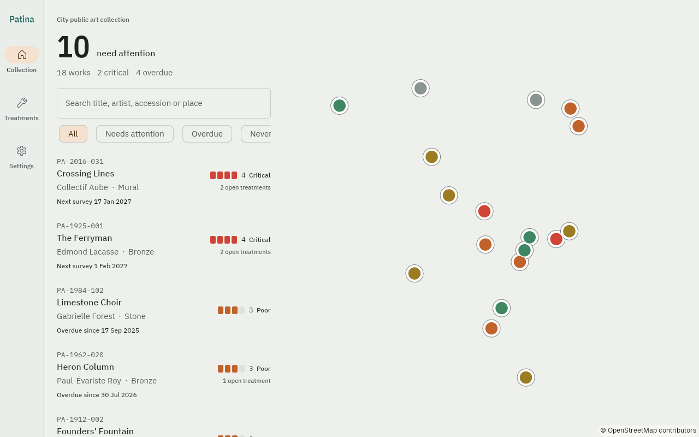
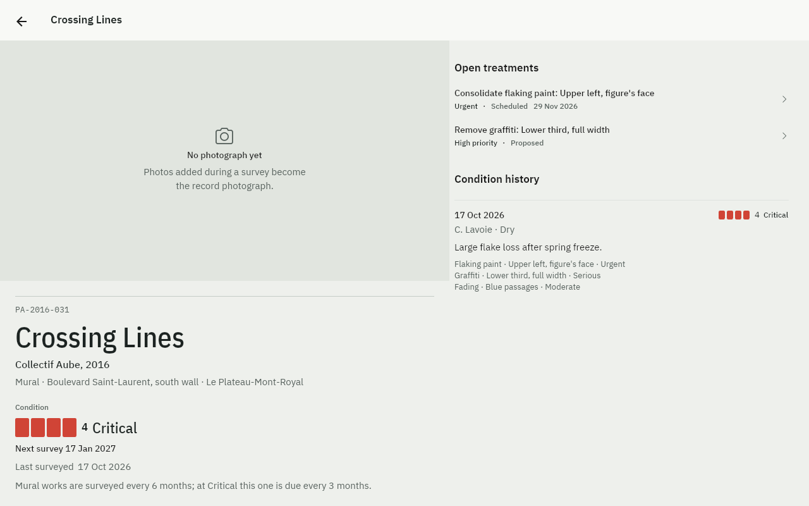
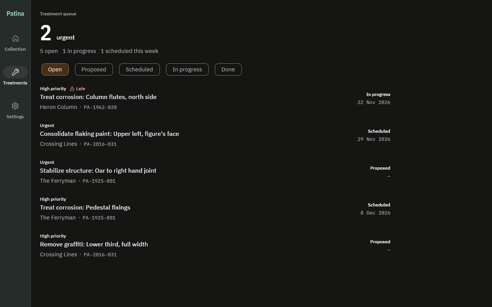
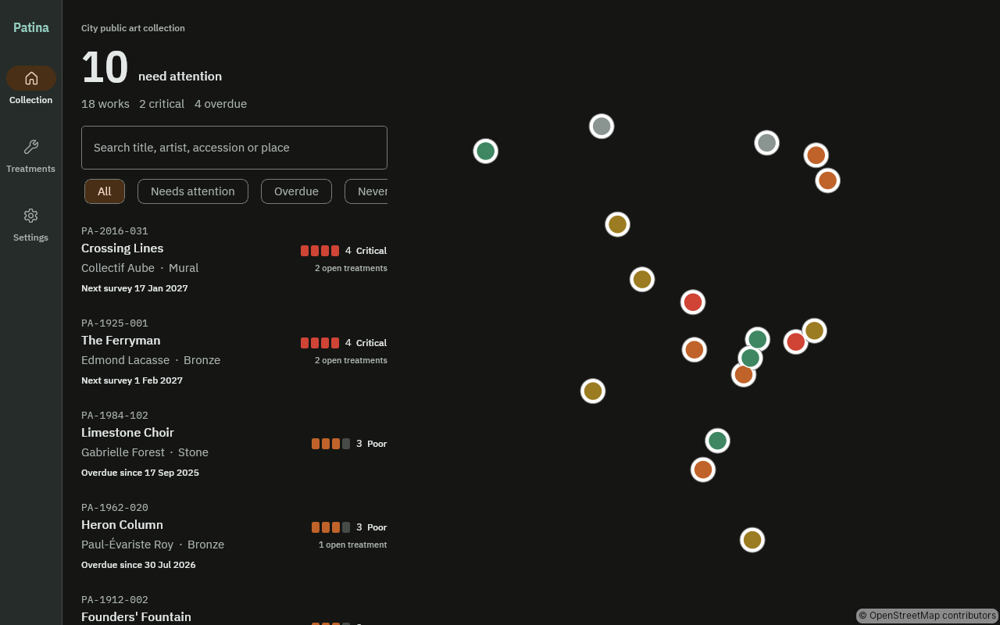
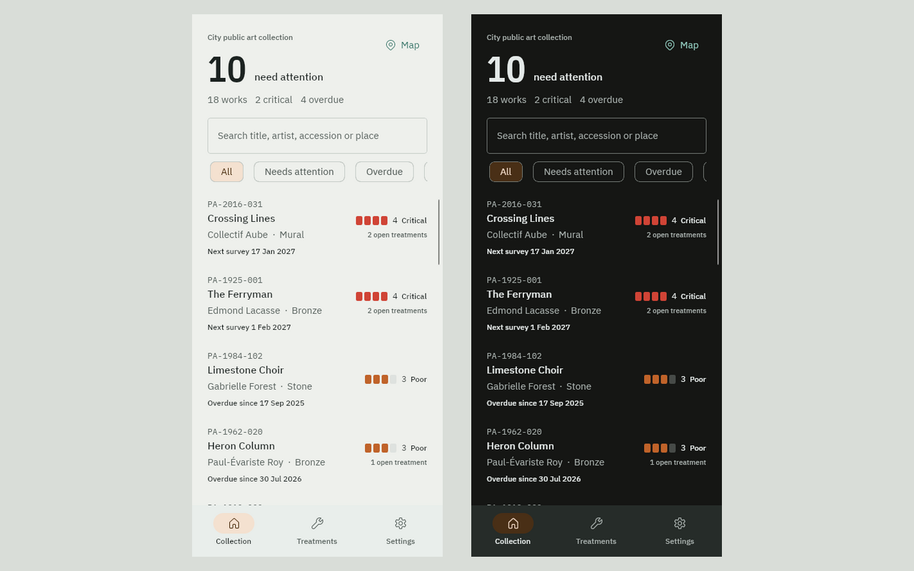

# Patina

**Owner:** Matthew Mattei (@noknowscode) · **Status:** ready for review

**What it is:** a local-first, bilingual (English / French) field app for a city's public-art conservation team:
condition surveys with findings and photos, a graded collection with a map, and a treatment queue, built on Uno
Platform with MVUX, Navigation Extensions, the Toolkit and Material.



Field app for a city's public-art conservation team. Conservators survey outdoor artworks (bronze, steel, stone,
murals, mosaic), record findings with photos, and the app grades condition, schedules the next survey and turns
serious findings into a treatment queue. Local-first, bilingual (English / French), built with
[Uno Platform](https://platform.uno) for Windows, macOS, Linux, the web, Android and iOS from one C#/XAML codebase.

The sample collection is fictional: invented works and artists placed at real Montréal sites.

## What it does

| Screen | Job |
|---|---|
| Collection | Every artwork ranked by urgency; search, filters, and a map of the city with condition-coloured pins |
| Artwork | Object label, record photograph, condition grade, next survey date and why, open treatments, survey history |
| Survey | Findings (type, zone, severity, photos), live grade, autosaved draft, submit |
| Treatments | Queue of proposed / scheduled / in-progress work, late work first |
| Treatment | Schedule, assign, log, step through to done (a completion note is required) |
| Settings | Surveyor name, reduced motion, language, export / import / restore sample data |

| Artwork record (Light) | Treatment queue (Dark) |
|---|---|
|  |  |
| **Collection (Dark)** | **Phone, 390 px (Light and Dark)** |
|  |  |

Rules (in `Patina.Core`, all unit tested): the worst finding sets the grade (three moderate findings count as Poor);
survey intervals depend on material and shorten with condition; submitting proposes one treatment per serious or
urgent finding.

## Repository layout

| Path | Contents |
|---|---|
| `Patina/` | Uno Platform single project (MVUX, Navigation Extensions, Toolkit, Material) |
| `Patina.Core/` | Domain records, rules, queries, JSON document store (plain `net10.0`) |
| `Patina.Tests/` | NUnit tests for Core (69) |
| `docs/` | Spec inputs: `DESIGN.md` (theme source), `DECISIONS.md`, `ANALYSIS.md` and `assessment/` (tooling and project review), `KNOWN-ISSUES.md`, `DEPLOY.md` |
| `SPEC.md` | The pre-implementation spec (briefs, route/page/data/design trees, gate) |
| `tools/` | `make_resw.py` (EN/FR strings from one table), Win32 capture/drive scripts, Playwright WASM checks |
| `.studiolive/`, `uno-sample.json` | The Studio info files, icon and screenshots |

## Prerequisites

- .NET SDK 10.0.300 or later (`global.json` pins Uno.Sdk 6.7.49, the latest Uno 6: Mapsui 5.1.0 has no Uno 7 build)
- Workloads for the heads you build: `dotnet workload install wasm-tools android ios`
- Android: JDK 17 and the Android SDK (API 36 used here). iOS: a Mac with Xcode.
- `uno-check` fixes most environment gaps: `dotnet tool install -g uno.check && uno-check`

## Run it

```bash
dotnet run --project Patina/Patina.csproj -f net10.0-desktop
```

Without the Android and iOS workloads installed, add `-p:PatinaTargetFrameworks=net10.0-desktop` so restore skips
those heads. The map draws OpenStreetMap tiles, so it needs network access; without it the pins sit on a blank ground.

## Build, run, test

To build a single head, also pass `-p:PatinaTargetFrameworks=<tfm>` (for example `net10.0-desktop`): it retargets
the app project only, not `Patina.Core`.

```bash
# Tests (Core rules, store, import/export, sample data)
dotnet test Patina.Tests/Patina.Tests.csproj

# Desktop (Windows / macOS / Linux, Skia)
dotnet run --project Patina/Patina.csproj -f net10.0-desktop

# WebAssembly (serve the published folder; any static server with an SPA fallback)
dotnet publish Patina/Patina.csproj -f net10.0-browserwasm -c Release -o publish/wasm
dotnet serve -d publish/wasm/wwwroot -p 8000

# Android (emulator or device attached)
dotnet build Patina/Patina.csproj -f net10.0-android -t:Run
```

Debug builds call `UseStudio()` for Hot Reload / Hot Design. For headless runs set `APP_NO_HOTDESIGN=1`.

## Changing the design

`docs/DESIGN.md` is the source for colour roles, type ramp, spacing and radii. Regenerate
`Patina/Styles/{ColorPaletteOverride,Typography,Tokens}.xaml` with DesignMd2Uno instead of editing them:

```bash
dotnet run --project <DesignMd2Uno>/src/DesignMd2Uno.Cli -- docs/DESIGN.md -o Patina/Styles --font-root ms-appx:///Assets/Fonts/
```

Strings: edit the table in `tools/make_resw.py` and run it; it writes both `Strings/en` and `Strings/fr` and lists
any key used in code or XAML that has no translation.

## Theming, layout and previews

- **Theme:** `App.xaml` merges `MaterialToolkitTheme` with `ThemeColors OverrideSource="Styles/ColorPaletteOverride.xaml"`:
  the Material roles carry the Patina brand in Light and Dark (verdigris `#2F6F62` primary, bronze secondary, slate
  tertiary, limestone `#EEF0EC` background, paper surface; Dark is "the same collection at night"), so Studio's
  Themes tab rebrands the whole app. The app follows the system theme (no in-app theme picker).
- **Tokens:** palette, type ramp (IBM Plex Sans, Sans Condensed, Mono on the Material style keys) and spacing/radius
  (`SpacingXs`…`Spacing3xl`, `RadiusSm`…`RadiusFull`) are generated from `docs/DESIGN.md` (see below). App-specific
  keys live in `Styles/Condition.xaml` (grade ramp and map pin colours, `Light`/`Dark`/`Default` theme dictionaries)
  and `Styles/Patina.xaml` (icon sizes `IconSizeXs`…`IconSizeLg`, content widths, text roles, shared state
  templates). Pages carry no hex colours and no text `FontSize`; the map reads its colours from these resources and
  redraws on `ActualThemeChanged`.
- **Responsive:** rail at 800 px and up, bottom tab bar below; the collection map pane joins the list at 1080 px and
  opens as its own page below that. Detail pages use `{utu:Responsive}`; the three cached pages use `AdaptiveTrigger`
  (Toolkit ResponsiveExtension bug, `docs/KNOWN-ISSUES.md`). Usable from 360 to 1920 px.
- **States:** every feed is shown in an `mvux:FeedView` with progress (also used as the undefined state), empty (with
  the action that fills it) and error (message and Try again bound to the FeedView's `Refresh`) templates. Pages read
  the document through `Presentation/StoreFeed.cs`: a `Feed.Async` over the store, refreshed by a signal on every
  committed change, so Try again really reloads after a failed read (a feed over `PatinaStore.Watch` ignored it);
  the treatment and survey form fields follow the same feed. Confirmation dialogs use the Material dialog style.
- **Every control does something real:** search, filter chips, list rows, map pins and callout, tabs, survey and
  treatment fields and buttons, and Settings all change persisted state, navigate, or open a platform picker/dialog
  (photo, export, import). Each was clicked through on desktop (2026-11-27); the pickers need the platform's file
  dialog (on Linux, an xdg-desktop-portal), and "Take photo" shows only where a camera capture UI exists (Android, iOS).
- **Hot Design previews:** `Patina/HotDesignPreviews/` (Debug only; absent from Release). `PreviewStore.cs` runs the
  real `PatinaStore` over a `PreviewDocumentFile` whose read stays pending (Loading), returns an empty collection
  (Empty), fails (Error) or seeds the sample collection in memory (Data); `PreviewNavigator`, `PreviewAppSettings`
  `PreviewPhotoService`, `PreviewLocalization` and `PreviewTransfer` fill the other constructor arguments. Previews:
  Collection, Treatments queue, Map, Artwork and Treatment (Data, Loading, Empty, Error), Survey (Data, Loading,
  Error), Settings (Data), plus the condition strip (every grade) and the object label.

## Data

Everything is stored on the device in `ApplicationData.LocalFolder`: `patina.json` (the collection, versioned) and
`photos/`. On the web that folder lives in the browser's IndexedDB. Settings > Export writes a `.patina` archive
(collection + photos) to move or back up a collection; Import replaces the device's collection after confirmation.
A damaged `patina.json` is set aside (`patina.corrupt-<time>.json`), never overwritten.

## Status

See `docs/DEPLOY.md` for per-target release steps and what was verified on which head, and
`docs/KNOWN-ISSUES.md` for framework workarounds.
